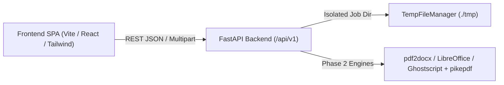

# DocConvertor Architecture

## 1. High-Level Overview

DocConvertor is a monorepo separating a **React + TypeScript SPA** (`frontend/`) from a **stateless Python FastAPI service** (`backend/`). There is no database, no user authentication, and no persistent user storage; all document jobs are scoped to ephemeral per-request temporary directories.

---

## 2. Frontend Architecture (`frontend/src/`)

| Layer | Directory | Responsibility |
| :--- | :--- | :--- |
| **Pages** | `pages/` | Route-level views (`HomePage`, `PdfToWordPage`, `WordToPdfPage`, `CompressPdfPage`, `CompressImagePage`, `NotFoundPage`). |
| **Layouts** | `layouts/` | Shared chrome (`MainLayout` with `Header` + `Outlet` + `Footer`). |
| **Components** | `components/` | Modular UI grouped by domain (`layout/`, `home/`, `tool/`). |
| **Services** | `services/` | Typed HTTP client (`apiClient.ts`) and endpoint wrappers (`healthService.ts`). |
| **Hooks** | `hooks/` | Reusable React hooks (`useHealthCheck.ts`). |
| **Utilities** | `utils/` | Tool registry (`toolsConfig.ts`) and formatting helpers (`formatters.ts`). |
| **Types** | `types/` | Shared TypeScript interfaces (`tool.ts`, `api.ts`). |

---

## 3. Backend Architecture (`backend/app/`)

| Layer | Path | Responsibility |
| :--- | :--- | :--- |
| **Entry Point** | `main.py` | Creates FastAPI app, configures CORS middleware, registers `/api/v1` router, and runs startup temp cleanup via `lifespan`. |
| **Configuration** | `core/config.py` | Typed `pydantic-settings` `Settings` loaded from `.env`. |
| **API Routers** | `api/router.py`, `api/routes/` | Modular FastAPI routers (`health.py` exposing `GET /api/v1/health`). |
| **Services** | `services/` | Processing boundaries (`pdf_to_word.py`, `word_to_pdf.py`, `compress_pdf.py`, `compress_image.py`). |
| **Validation** | `utils/validation.py` | Extension and file-size validation helpers. |
| **Temp Storage** | `utils/temp_files.py` | `TempFileManager` for UUID-isolated job folders and TTL cleanup. |

---

## 4. Planned Processing Stack (Phase 2)

- **PDF to Word:** `pdf2docx`
- **Word to PDF:** LibreOffice headless (`soffice --headless --convert-to pdf`)
- **Compress PDF:** Ghostscript + `pikepdf`
- **Compress Image:** Client-side Browser Canvas / `browser-image-compression`
